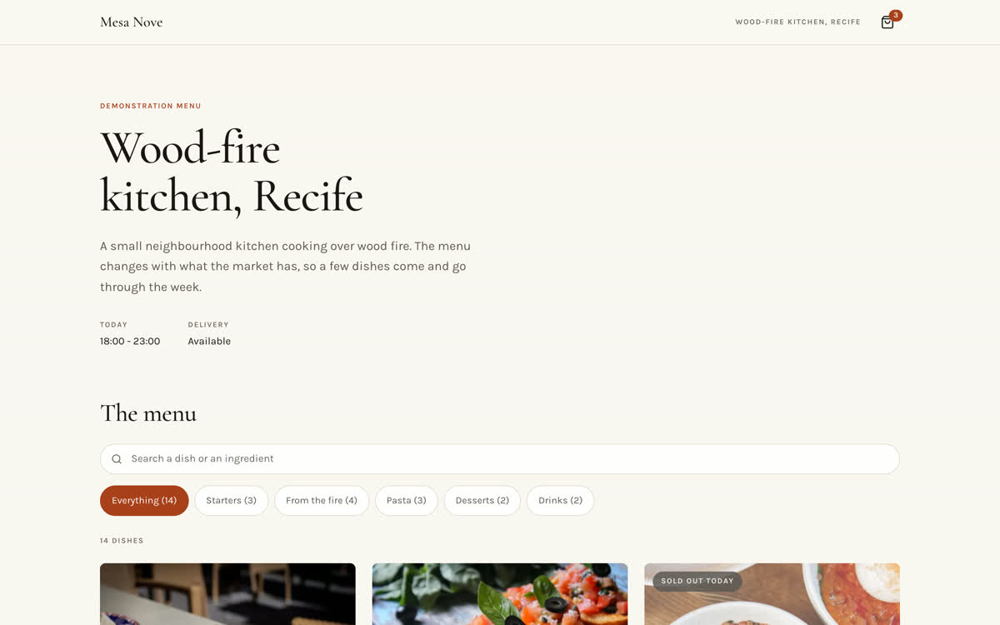
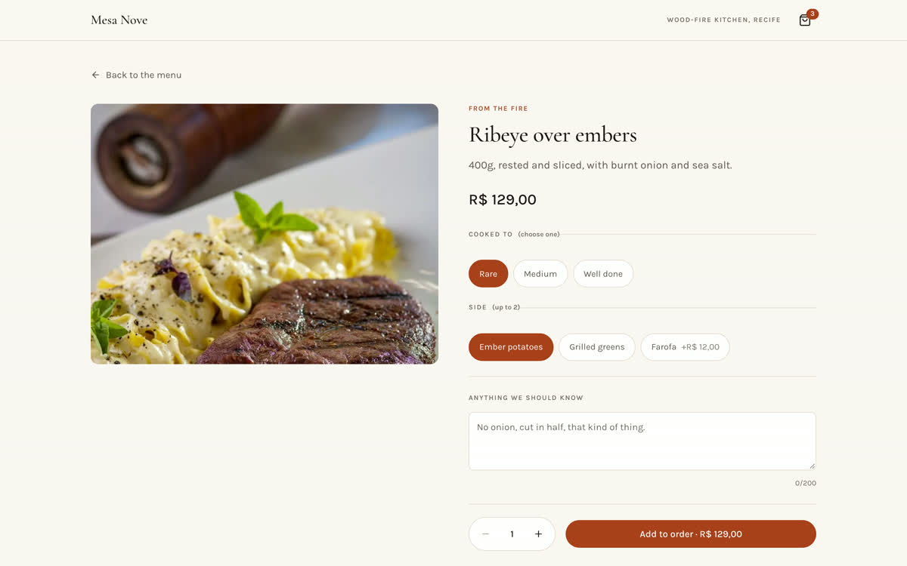
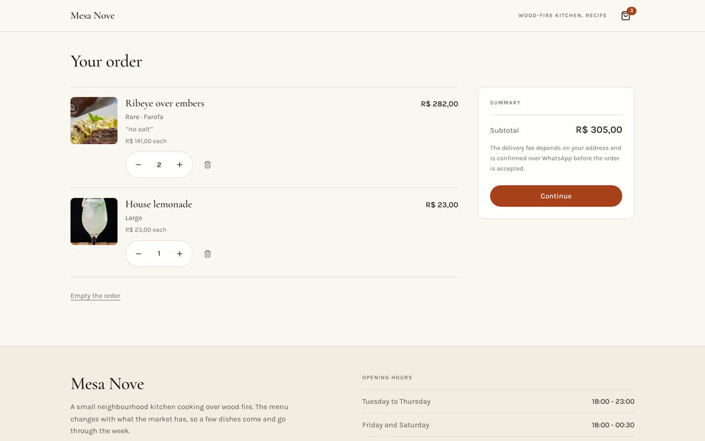

# MenuFlow

A digital restaurant menu that takes an order and hands it to WhatsApp. Built
as a portfolio piece: a small restaurant can put a real menu online, let a
customer build an order on a phone, and receive it as a message it can act on,
without a backend, a database or a payment provider.



## The problem

A neighbourhood restaurant that wants to take orders online has two options:
a delivery marketplace that charges a commission per order, or a PDF of the
menu and a phone number. The first is expensive, the second produces orders
that arrive as "the usual, but no onion" and have to be reconstructed over
several messages.

MenuFlow is the middle: the customer assembles the order themselves, with the
real prices and the real options, and the restaurant receives it written out
in full on the channel it already uses.

## What it does

- **Menu** with categories, a filter and a search that reads dish names *and*
  descriptions, so searching an ingredient finds the dish.
- **Dishes that sold out** stay visible, marked, and cannot be ordered.
- **Customisation** with option groups that carry their own minimum and
  maximum, so "pick one size" and "pick up to two extras" are the same
  structure. Prices update as options are chosen.
- **Cart** persisted in `localStorage`, with per-line notes and quantities.
  The same dish with different options stays on separate lines.
- **Checkout** for pickup or delivery, collecting only what each one needs,
  and producing a WhatsApp message with every line, option, note, unit price
  and the subtotal.




## What it deliberately does not do

Opening WhatsApp is not the same as placing an order, and the application says
so: the order is confirmed when the restaurant replies. Nothing simulates a
payment. No delivery fee is invented — the catalog carries a note saying the
fee depends on the address and is confirmed in the conversation, and that note
travels with the message.

## Stack

Next.js (App Router) · React · TypeScript strict · Tailwind CSS v4 ·
Lucide icons · Vitest · Testing Library · ESLint.

No database, no authentication, no paid service. The menu is a typed file.

## Running it

```sh
npm install
npm run dev          # http://localhost:3000
```

```sh
npm run typecheck    # tsc --noEmit
npm run lint         # eslint
npm test             # vitest run
npm run build        # production build
```

## Architecture

```
src/
  app/                 routes: menu, product, cart, checkout
  components/
    layout/            header, footer, cart indicator
    menu/              browser, filtering and search UI
    product/           card, customiser
    cart/              provider, cart view
    checkout/          order form
    ui/                image with fallback
  data/catalog.ts      the menu itself
  domain/              catalog, search, pricing, cart, order
  hooks/useCart.ts     cart state
  lib/                 money, storage, cart store
  types/menu.ts        shared types
  tests/               domain and interface tests
```

Business rules live in `domain/` as pure functions and are tested without
rendering. Components read them; they do not re-implement them.

### Two decisions worth knowing

**Money is integer cents everywhere.** Prices are only divided at the moment
they are displayed. A menu that drifts by a cent on a large order is a menu
nobody trusts.

**The cart is priced against the current catalog on every render**, never from
a value stored with the line. A cart can sit in a browser for weeks and the
menu is reprinted far more often than that. Dishes that have sold out are
dropped and the customer is told.

## Configuring the menu

Everything lives in [`src/data/catalog.ts`](src/data/catalog.ts): the
restaurant, its hours, its WhatsApp number, categories, products, prices in
cents and option groups.

| Field | Notes |
|---|---|
| `restaurant.whatsapp` | Digits only, country code included, as `wa.me` expects. Validated: a malformed number produces an explanation instead of a dead button. |
| `restaurant.delivery.feeNote` | Shown at checkout and sent with the order. Say how the fee is decided; do not put a number here unless it is really fixed. |
| `product.price` / `choice.priceDelta` | Integer cents. `12900` is R$ 129,00. |
| `optionGroups[].min` / `.max` | `min: 1, max: 1` is a required single choice. `min: 0, max: 2` is up to two optional extras. |
| `product.available` | `false` keeps the dish on the menu, marked and unorderable. |

`catalogProblems()` in `src/domain/catalog.ts` reports structural faults and a
test asserts it comes back empty, so a malformed menu fails the suite rather
than reaching a customer.

## Tests

82 tests. The domain is covered as pure functions; the parts a customer
touches are covered through the rendered interface, which is where the last
two real defects actually appeared.

Covered: category filtering and a search that returns nothing; option and
extra pricing; adding, removing and changing quantities; storage persistence,
restoration and corruption; unavailable dishes; the same dish with different
options staying separate; pickup, delivery and when an address is required;
the finished message, the `wa.me` URL and special characters in it.

## Deploying

The app is static apart from its client interactivity and needs no
environment variables.

```sh
npm run build
npx vercel            # preview
npx vercel --prod     # production
```

## Limitations

- The restaurant, **Mesa Nove**, is fictional and the WhatsApp number is a
  placeholder. Replace both before using this with a real business.
- Photography is from Pexels, downloaded into `public/menu`; photographer
  credits are in `public/menu/CREDITS.json`.
- There is no order history: once the message is sent, the application knows
  nothing more about it.
- Verified in Chromium at 360, 390, 430, 768 and 1440 px. Not tested on a
  physical device, and not tested in Safari or Firefox.

## Roadmap, deliberately not built

An admin panel, a database, login, online payment, order management, coupons,
multiple restaurants, analytics and kitchen printing. Each would need a
backend and change what this is. They are written down rather than simulated:
nothing in the interface pretends any of them exist.

---

See [`docs/CASE_STUDY.md`](docs/CASE_STUDY.md) for the decisions behind it.
